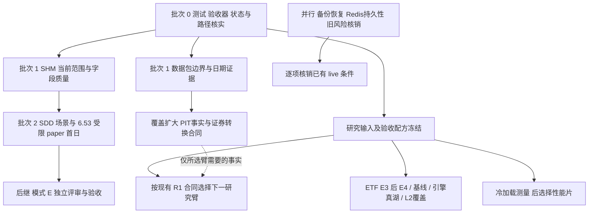

# 三个量化仓库未收尾事项与统一实施计划

> 状态：盘点与排期提案；按用户要求「把最近三个量化仓库未收尾的事情找出来，统一规划」。
> 2026-10-30。已确认方向：**只拆包，不拆业务仓库**。此前已明确的逐片 GO 继续有效。
> 本次交付是计划与证据索引；新增的资金执行、默认源切换、生产部署分别沿用原域授权及验收要求。

建议先修测试和验收器的明确缺口，再在目标宿主集中收尾**共享内存 → SDD → 6.53 受限 paper 首日**。数据服务独立运行、公司行动日期补证、研究侧验收可以另线推进。不要把所有后置功能都塞成首个 paper 日的前置条件。

盘点归并为 **21 个实施包、64 条审计记录**。记录包括待实机验收、待复现、旧台账待核销、明确后置项及盘点期间刚完成的 #1258，不能理解为 64 个已确认故障。逐项动作、完成条件和来源见[事项明细](three-repo-closeout-inventory-2026-10-30.md)；可机读映射见 [inventory.json](evidence/three-repo-closeout-2026-10-30/inventory.json)。

## 1. 盘点范围与证据等级

从 2026-09-01 三仓分工调整前后开始，索引更新过的 PR、全部开放 PR/issue、当前主分支的计划、运行记录、风险台账、入口代码及 CI 配置；同时追查仍被活入口引用的更早未结项。共索引 **1,549 条 PR 记录**，对相关未闭环线索追到代码或签收记录，并非逐行审计所有 PR。

| 仓库 | 本轮源码快照 | 近期 PR 记录 | 快照时开放 PR / issue | 当前职责 |
|---|---|---:|---:|---|
| OSkhQuant1.3 | [`7e52e6e0cd6a`](https://github.com/baiyibing/OSkhQuant1.3/commit/7e52e6e0cd6a289ad04bccaefb5edced40850841) | 903 | 2 / 2 | 交易与执行验收；外部采集、vendor 合并及独立数据服务 |
| MyQuant | [`7c428d9bcb66`](https://github.com/baiyibing/MyQuant/commit/7c428d9bcb66c0dde37ec203a2b5fcc28ac9f1e8) | 109 | 0 / 0 | Qlib 派生特征、训练、信号及冻结研究意图 |
| MyQuant-backtrader | [`418496378ebe`](https://github.com/baiyibing/MyQuant-backtrader/commit/418496378ebefc4e707879f9859774b0b8f67284) | 537 | 3 / 1 | 向量化研究、成交/NAV、只读消费数据湖 |

**交付前增量复核（2026-10-30 17:54 北京时间）**：1.3 [#1258](https://github.com/baiyibing/OSkhQuant1.3/pull/1258) 已于 17:50 合入，最新 head `ceff70d3` 的检查为 18 SUCCESS / 1 SKIPPED；main 前进至 [`1ed67467890e`](https://github.com/baiyibing/OSkhQuant1.3/commit/1ed67467890edb6c931bf8816c121fa7483cc276)。已核 compare，仅该 PR 的 7 个测试/场景辅助/契约编排文件变化。其余两仓 head 不变；上述 5 个开放 PR 中本项已关闭，剩 4 个。本文保留原始源码快照，应用这次增量；[刷新记录](evidence/three-repo-closeout-2026-10-30/github-refresh.json)。

本文使用以下状态：**待实现**＝当前缺代码或合同；**待验收**＝已有实现但缺目标场景证据；**待核销**＝旧记录未关，尚不能认定今天仍有问题；**后置**＝已有明确延期或须单独选择范围。单测通过、PR 合入、进程退出 0、数据有行数，分别不能替代真实宿主、实际执行路径、业务结果和字段质量的签收。

限制：本轮没有重新登录 75/4090 运行任务，没有启动 QMT/paper、发送通知、写行情湖或执行训练；未直接读取外部 VM 上的 Phase0 原始冻结目录，只读取仓内镜像/记录。因此，宿主上的计划任务是否存在、数据是否已补齐、运行验收是否在仓外完成，都须用新回执核实。下文历史数字均保留原时间和口径。

## 2. 三条重点线的真实停点

| 用户关心的事项 | 已完成部分 | 本轮应收尾 | 另列或继续后置 |
|---|---|---|---|
| **共享内存** | v1_36 桥接与下载接线；10/24 显式取消、`cancelled` 入环、随后 daily 不 busy 已 PASS | 当前必过范围 **1m + 1d** 的完整 job/evt/item/身份/读回矩阵；volume、停牌字段和水位；独立桥进程监督、恢复与回滚 | 180 秒失联 lease 自动取消仍未证明，但继续 Phase B 已后置；5m/15m/30m/60m/1h 已降为可选，不重新加成阻塞项 |
| **SDD 单活跃日槽** | S0/S1/S2、keeper/observer、工具及 default-on 已落地 | 目标 Redis/进程的缺槽、错槽、双开、同日换 profile 拒绝；连续三次失败停止新意图/submit、继续处理 fill/reconcile/cancel；新交易日人工换槽 | 自动 clean-stop、完整 drain/seal 和进程内换日仍 HOLD；已批准的人工路径可用于受限 paper，不恢复已退役的文档仪式 |
| **6.53 策略迁移** | P4-01～08 离线实现、W1～W6 接线、paper GO、首日 runbook/precheck | 测试修复 #1258 已合；落实真实配置与源 B；首个 paper 日的直接 cycle、订单到本地状态、EOD 快照及冻结残余、停止与人签 | parking / profit-skim 目前仅 observe、执行关闭；模式 E 完整资金语义及执行须独立 L3 红队与验收；受限 paper 完成不等于完整迁移完成 |

证据与细目：[P03](three-repo-closeout-inventory-2026-10-30.md#p03)、[P04](three-repo-closeout-inventory-2026-10-30.md#p04)、[P05](three-repo-closeout-inventory-2026-10-30.md#p05)、[P06](three-repo-closeout-inventory-2026-10-30.md#p06)。6.53 以**已冻结的跨仓规则合同**验收；不借迁移顺带切到回测仓最新研究默认值，也不把全部新策略基线接入当成 paper 新门槛。

## 3. 跨仓边界与统一完成标准

1. **同仓拆包、运行独立。** 巨潮采集、外部数据接入、通知仍归 1.3，沿已有包拆依赖、入口和进程监督。交易停机或非交易日，数据任务仍可运行。MyQuant 管自己的派生刷新；BT 管消费验收。已有 BT Wind/AI pull 曾获窄范围授权，后续迁回 producer 能力时保留必要兼容入口和历史冻结产物，不把旧授权描述为违规。
2. **运行日与目标行情日分开。** QMT 下载支持盘后及非交易日补历史。调度需显式记录最近已完成行情目标日、运行日、前复权全量刷新策略；不能仅看周日这个运行日，也不能用程序退出 0 代替逐批失败和水位汇总。停止任务须明确取消 QMT 端 job，不能只杀 Python。
3. **每台机器明确根路径。** 本机、4090 无 F 盘，75 物理机有 F；这是用户确认的部署事实，不是代码默认。行情根、workspace、Rust 构建缓存分开登记。只经配置与 `.authority` 解析，缺配置/缺文件失败，不探盘、自动搬盘或回落到另一湖。
4. **事实、推导和经济口径分开。** 公告明确日期保存字段级来源与可用时间；「缺红股上市日时用除权日」可作为可调整的兼容推导，明确标记，不能冒充公告事实。现金事件不因不适用的红股日期缺失而误阻塞。数据调度、字段补证、经济审批、合湖发布、主源切换分别留证。
5. **运行证据按能力复用。** 同一宿主记录可供 SHM、SDD、6.53 引用，但每个合同分别给 PASS/FAIL/NOT_TRIGGERED。至少记录 host、源码 SHA、脱敏配置摘要、vendor、输入/名单 hash、run-id、UTC/交易日、直接事件、输出 hash、水位和停止结果。无触发就写未触发，不根据侧面结果补签。
6. **只维护一份活状态。** 本文是统一排期快照；完成每片后，回写原域 SSOT/风险登记/运行记录，再在此链接回执。已替代的旧计划标 superseded/retired 并指向新入口，不重新制造第二本运行台账。

涉及 1.3 的实施继续遵守其[设计原则 ①–㉑](https://github.com/baiyibing/OSkhQuant1.3/blob/7e52e6e0cd6a289ad04bccaefb5edced40850841/docs/architecture/design-principles.md)：重点核①职责隔离、②既有跨进程通道、③策略账本隔离、④水位幂等、⑤失败关闭、⑥冻结规则同源、⑨追踪身份、⑩状态单源、⑲部署 vendor 单选、㉑决策价格源边界。独立数据服务不因此增加第四条交易总线，下载湖不进入实时下单决策价格回退。

## 4. 统一工作包

优先级用于排期：**先收尾**是近期可执行片；**依赖就绪后**按数据/宿主条件推进；**核销**先核证据；**后置**保留目标。每行链接到完整来源与验收条目。负责人列表示仓库职责，不代表已向任何 bot/人员派单。

| 包 | 归口与状态 | 交付及完成条件 | 依赖/顺序 |
|---|---|---|---|
| [P01](three-repo-closeout-inventory-2026-10-30.md#p01) 测试与验收器 | 三仓；先收尾 | 1.3 #1258 已合，保留回执；MyQuant 5 个既有 ETF/分钟 staging 测试进 CI；BT 真湖验收器显式记录 `rule-profile`/revision/实际费用合同并校准低现金判据；复核 Windows CRLF 测试线索 | 可先做；不重复开 #1258 的实现 |
| [P02](three-repo-closeout-inventory-2026-10-30.md#p02) CI 与合并检查 | 三仓；待运行/管理配置 | 1.3 两次真实 nightly 的历史、chunk/重试日志及分类；按仓形成 required-checks 可执行方案和验证回执 | #1258 相关修复后观察；当前主分支 CI 可绿，不能称全面红；1.3 rulesets 403 是套餐能力限制，不能写成空规则集 |
| [P03](three-repo-closeout-inventory-2026-10-30.md#p03) 路径与数据质量 | 1.3 生产、两仓消费；先核实 | 三机 authority/根路径记录；OHLC、volume、suspendFlag、单位/水位质量；TR/BJ/缺 bands 宇宙清单 | 是宿主数据验收共同输入；10/24 分钟 volume 全 0 的记录须重查，通道成功不代签 |
| [P04](three-repo-closeout-inventory-2026-10-30.md#p04) SHM | 1.3；待实机验收 | 当前 1m+1d 矩阵和桥/shim 运维证据；旧 v3.1 方案与已合实现的状态映射 | P03 中本部署根路径/实际消费字段 + 对应 QMT/桥版本；显式取消已过场景引用旧证据，按必要性抽验 |
| [P05](three-repo-closeout-inventory-2026-10-30.md#p05) SDD + 6.53 首日 | 1.3；待实机验收 | 真实 Redis 日槽场景与受限 paper 首日逐项 runbook，分别给结论、共用产物 | P01 相关测试、有效源 B、批准名单/目标配置；使用 SHM 下载的部署先完成 P04 对应能力 |
| [P06](three-repo-closeout-inventory-2026-10-30.md#p06) 6.53 模式 E | 1.3 + BT 冻结合同；后继 L3 | 红队、equity/抽离本金事实、停泊/利润抽离执行语义及资金守恒；未完成保持 execute=false | P05 基础路径证据；独立执行范围，不阻塞受限首日 |
| [P07](three-repo-closeout-inventory-2026-10-30.md#p07) 独立数据服务 | 1.3 主、MyQuant 派生；待实现/验收 | 同仓包边界、独立入口与监督；停止交易后的采集/通知运行；盘后/非交易日补数、恢复和失败回执；RAGFlow 集成边界 | 可先审现有依赖；完整 Phase0 G0 仍 NO_GO，离线/独立 CLI 已有授权不被扩成新总前置 |
| [P08](three-repo-closeout-inventory-2026-10-30.md#p08) 公司行动日期 | 1.3 生产、BT 消费；既有 GO 后续 | 收口 #1256/#538 与 #531/#532 重叠范围；162 个现金事件+D11 的明确日期补证、字段来源和 as-of 合同 | 保持生产/消费分工；不等待 P07 全部服务切换 |
| [P09](three-repo-closeout-inventory-2026-10-30.md#p09) 覆盖与证券转换 | 1.3 事实、BT 研究模型；待补证/设计 | D11、31 个 Wind-only 历史键；扩大巨潮对比；东兴换股独立证券转换事实及未来消费合同 | 与 P08 共用冻结 2,774 码宇宙；换股不能塞入现金/送转字段；合湖/换主源另验 |
| [P10](three-repo-closeout-inventory-2026-10-30.md#p10) ST/ETF/PIT 事实 | 1.3 主，MyQuant/BT 合同；待补证 | ST 两宿主记录核对；ETF front 全零及分钟缺行最新 manifest；历史行业/市值、IPO/复牌价格限制、CYQK 快照时间事实 | P03；当前快照不能冒充 PIT 历史 |
| [P11](three-repo-closeout-inventory-2026-10-30.md#p11) ETF Qlib | MyQuant；E3/E4 待实机 | E3 真 provider dump/readback、4 ETF 精度/域校验；E4 固定划分 Alpha158 + 小 LGB 和有限有效 IC | P10 中 ETF 所需输入有效、P01 对应 CI；E3→E4，不靠反复调参凑结果 |
| [P12](three-repo-closeout-inventory-2026-10-30.md#p12) Qlib 派生与合同 | MyQuant；待完善/实机回执 | 派生每日刷新与完整性；分钟增量回执；必需 manifest 写失败语义；scores-only 首次空 bundle 和 available-at 校验 | 与 P07 调度衔接；17 字段 archive/CSV 与纯湖路线先核必要性 |
| [P13](three-repo-closeout-inventory-2026-10-30.md#p13) 策略基线 | BT；待接入/静态对照 | 14 本 pending 策略逐本决定正式基线/实验/退役；策略 11 D 静态档案对照；策略 12 lot0 策略取舍及确需的组合验收 | 冻结规则与档案；不复活 Cerebro，不因 pending 就称策略未实现 |
| [P14](three-repo-closeout-inventory-2026-10-30.md#p14) 引擎真实验收 | BT；待宿主 | 成交核 Slice D 与 L1/native 真湖矩阵，共用运行包、分别验合同 | P01 验收器修复 + P03 合法输入；不重做已完成 L1/L2 实现 |
| [P15](three-repo-closeout-inventory-2026-10-30.md#p15) 分钟性能 | BT；先测后改 | S1.1 冷加载探针实机数字；按瓶颈选 S1/S2/S3；缓存/布局保持结果一致，明确失效条件 | 先冻结代表性输入；不重写已完成 Numba 热路径，不盲开全部优化 |
| [P16](three-repo-closeout-inventory-2026-10-30.md#p16) L2 全量与重复行 | BT 离线 ETL；待真实覆盖/语义 | 最新 Phase3 manifest/progress/failure 清单；distinct-ID 连续性与完全重复行分开，量额/笔数对账 | 宿主文件与现行规则；旧剩余约 370 天仅历史估计，不作为当前剩余数 |
| [P17](three-repo-closeout-inventory-2026-10-30.md#p17) TopK/联合收益 | MyQuant + BT；分片后继 | P-CHASE/弱信号源；R2 换手预算、R3 组合约束、R4 执行敏感性、R5 报告/R6 下一组；#164 Q8 等研究问题、G5 同分钟资源优先级裁决 | 选择下一研究臂并冻结假设；R3 依赖对应 PIT 事实，P-BASE 对照保留 |
| [P18](three-repo-closeout-inventory-2026-10-30.md#p18) 既有 live 条件 | 1.3；旧 P0 未签收 | R1 修复后 3 个实际 paper 日等直接证据；五库异机/异盘备份+隔离恢复；603556 遗留 lot 决策与验收 | 独立 live 条件；与受限 6.53 paper GO 分别核对，不以新 GO 自动冲销旧账 |
| [P19](three-repo-closeout-inventory-2026-10-30.md#p19) Redis/费用 | 1.3；部分实现、待运行/设计 | Memurai 持久配置重启回执；GAP-1/2 持久性与跨重启窗口合同；手续费异常 writer 的实际交易日观察结论 | GAP-3 hook 已做；不拿临时 CONFIG SET 或日历已过两周代替签收 |
| [P20](three-repo-closeout-inventory-2026-10-30.md#p20) 旧账核销 | 三仓；先查再归档 | 7 项旧 runtime pending、#34/#37、北斗真 xlsx、BL-001、旧 L2 C/D/E 路线和 CYQ 状态逐项引用新证据或明确关闭理由 | 可以先做；被替代/合法负结果可关闭，不强迫重新实现旧 CSV/live 路径 |
| [P21](three-repo-closeout-inventory-2026-10-30.md#p21) 后置扩展 | 三仓；保留后置 | SDD clean-stop；旧 13 项结构/清理待办；Qlib TTL/分片等有测量再启；BT B-L2/δ5、minute_orders 后继合同 | 不列普通研究或受限 paper 的硬前置；每片恢复时重新明确价值、范围、验证 |

## 5. 实施批次和依赖

按工作批次推进，不虚构自然日工期。宿主运行、真实交易日观察、数据供应恢复均有外部等待；开发片和运行片分别估量。一个仓库同一模块同时只保留一条实现线；跨仓测试修复、离线补证可以并行。1.3 的 host-lock 和逐片窗口沿原流程消化，本文的并行安排不授权同夜多轨编码。

图中的 SHM→首日表示采用该下载能力的部署依赖；有效源 B 也须按冻结合同保留 mini/daqmt 两腿去向。一次部署只选一个 vendor，不日中双腿切换。研究不等待 live 条件全部收官；数据日期补证也不等待 Phase0 整体生产切换。联合研究 R4 不等待 R2/R3，R5 可从 R1 最小 summary 开始；PIT 仅阻塞依赖该事实的臂，不把 P09/P10 全包变成总前置。

### 批次 0：先把验收基础和当前工作归拢

| 小片 | 具体变更/交付 | 验收与结束条件 |
|---|---|---|
| 0A：1.3 #1258 已完成 | 最终 head 检查通过且已合入；保留这次盘点中的关闭记录 | 不再安排编码/合并；后续两次实际 nightly 的日志与历史观察单独归 P02 |
| 0B：MyQuant CI 五文件 | `.github/workflows/ci.yml` 显式加入已存在的 ETF/分钟 staging 离线测试 | 真实 CI 命令执行五文件，无真湖/QMT/训练要求；不重做已接入的 joint-return 测试 |
| 0C：BT 验收器 | `verify_run_protocol_lake_parity.py` 为 native/facade 选择同一显式 profile；把当前 industry 的 shrink/skip 与 legacy 的抛错分别验；修掉 manifest 的旧固定费用标签 | 小样本验证成功/拒绝路径，manifest 记录 profile/revision/实际费用合同；低现金格须有 shrink 或 skip_cash 直接证据，无触发仍 NOT_COVERED；之后才能凭真湖矩阵判引擎结果 |
| 0D：宿主与台账清单 | 读取已声明配置/marker，列本机、4090、75 根路径与读写角色；核旧 issue/运行条目是否已被替代 | 每条为已证/待宿主回执/已替代，链接证据；不能以旧盘符文档触发自动搬盘 |
| 0E：当前数据 PR 收口 | 对齐 1.3 #1256、BT #538 两端 artifact 合同；将 #531/#532 尚有价值的计划/兼容项归位 | 无两套 producer/consumer；日期后续沿已有计划，备份目录改名先核所有读者兼容 |

0B、0C、0D 的离线部分可并行；0A 已由原 PR 完成，无需另开修复。当前计划先交付这些可审片的范围，实际实施时以任务所需的最新主分支建立隔离分支，不能覆盖根目录已有未提交修改。

### 批次 1：数据端口可独立运行、当前行情能力可验

**交易基础线：P03 中适用项→P04。** 只取目标宿主、所用根路径与实际消费字段；其他机器、TR/BJ 等研究覆盖不成为该宿主的总前置。明确运行宿主与唯一桥；用当前必过 1m+1d 窗口验证任务、事件、item 身份、字段质量、水位和必要的取消/恢复路径。10/24 的显式取消 PASS 保留；180 秒失联自动取消和可选多周期继续按原后置决定管理。

**数据线：P07/P08/P09 的离线片。** 先画现有包、入口、进程和持久状态的依赖表，再按采集→通知→调度→RAGFlow 消费适配逐片收口。`stop_turtle_paper_procs` 当前默认停止 ops daemon，通知 ACK/升级还有 Monitor 依赖；仅加 `--keep-daemon` 不能代签通知完全独立。按 system/breaker/cninfo 域分别冻结必需能力及未覆盖项，逐域核发送、ACK、升级和失败语义；某域通过不代签其他域。验证没有交易进程时盘后增量、周末补历史、失败重试与显式停止。

已有 Phase0 W01～W06 离线原型与 W07 实际通知、H/Q/G0、双跑是不同停点；G0 仍 NO_GO、双跑未开始。先沿已授权 CLI 完成日期补证；完整服务切换仍引用原 Phase0 的逐项要求。RAGFlow 的本地部署是已有上下文，仓内 `.222 /raghot` 仅能证明存储规划：需要另核实际 API、dataset、文档身份/去重、删除更新、失败重试及通知关系，不能宣称已经接好。

公司行动工作保持冻结 2,774 码宇宙，先处理 162 个现金事件和 D11 查询目标。补日期不得无声修改现金/送转金额。东兴换中金按证券转换记录原/目标证券、比例、登记/退市/上市及可用时间；先交事实与研究合同，持仓迁移、零碎股和成本结转作为独立消费片。D11 与 31 个 Wind-only 历史键保留逐项结论，扩大巨潮对比后再讨论主源地位。

### 批次 2：同一宿主集中完成 SDD 与受限 paper 首日

以[现有首日 runbook](https://github.com/baiyibing/OSkhQuant1.3/blob/7e52e6e0cd6a289ad04bccaefb5edced40850841/docs/operations/v653-paper-first-day-runbook.md)为入口，准备目标 host、runtime、账户/userdata、Redis、独立 DB/schema、批准名单和合法新交易日日槽。按现有顺序执行 precheck/preflight/dry-run 和首日路径。

SDD 的错误配置/双开/失租场景先在明确的验收实例和隔离命名空间演练，记录拒绝埋点；不对正在承载任务的运行实例无计划注入故障。首日真实过程复用配置身份与证据目录，分别签收 SDD、cycle、首笔订单到本地状态、EOD、停止。新交易日人工换槽路径保持可用；无首笔订单的安静 paper 日可签 cycle/EOD/stop 子项，intent→execution_log→action-state 仍未签，真实触发后才可关闭整个首日包。P18 的 R1 三个实际 paper 日有自己的修复版本和直接事件口径，不能用这一个首日自动冲销。

### 批次 3：研究侧按输入就绪收尾

先按 P10 分出 ETF、ST、PIT 等各自输入，不把整个 P10 做成一个总闸。ETF 数据合格后 **E3→E4**；BT 验收器修复后跑 P14 真湖矩阵；P13 逐本处理 14 个 pending 策略与策略 11 D 静态对照。正式、实验和退役三种结论都合法，不能为清列表批量改 golden。策略 12 D 已完成，只保留实际未决规则/组合。

P16 先产当前全量覆盖 manifest，再决定补跑量；连续 ID 与重复行是否应删除分别判定，任何删除或历史重写另立明确范围。P15 先测 cold/warm、时间/内存、输入规模和输出一致性，证据支持哪片再开哪片。已完成的 Numba 路径、4090 5,474 码 A/B 和 joint-return P-BASE B～G 不重做。

### 批次 4：扩展研究与长期运行收尾

P17 选择一个可解释的下一研究臂：选 R2 时冻结换手预算/信号源；选 R3 时需要对应 PIT 事实；R4 可从已完成的 R1 进入 M-DELAY/M-NOFILL，无须等待 R2/R3；R5 可先封装 R1 最小 summary，再增量接入其他已交付臂。P-BASE 保留对照，负结果允许结束。G5 同分钟资源先后次序先裁合同，不让 symbol/hash 偶然顺序变成经济规则。

P18/P19 的备份恢复准备、Redis 持久配置核查和已有风险证据整理可从批次 0 并行启动；需要真实交易日的观察依次累计。完成后逐条关闭旧 live 条件，再谈相应上线范围。P06 模式 E 与 P21 后置扩展分别形成下一份窄计划，不随本总计划批量 default-on。

## 6. 已完成、已取消、以及不能当成新阻塞的事项

- MyQuant #102 的 **4090 全 5,474 码 A/B 已 PASS**，四文件字节一致；旧 PENDING 页眉应核销。[真实回执](https://github.com/baiyibing/MyQuant/pull/102#issuecomment-5828997739)
- joint-return P-BASE 时钟合同 B～G 及 BT Mode B M-REF/M-LAG 已完成；MyQuant M2 不可比、M3 负样本外、M5 零交集及 T5 负候选是可接受的结束结论，不因效果不好重列「未完成」。
- TopK 已在正式 BOOK_NAMES 中；本轮 14 本 pending 名单不含它。策略 11 D 未完成与策略 12 D 已完成分别登记。
- SDD 基础代码/default-on、6.53 P4-01～08/W1～W6、SHM 显式取消、Redis GAP-3 hook、G31 baseline 修复已有证据；收尾重点是剩余运行证据与台账回写。
- #391 已退役的 `bar_scan_exit/minute_true_core_wire`、Cerebro/Rolling 和旧 CSV live 不复活。#402 v7/APP 主引擎迁移已完成；B-L2/δ5 认证已降为可选，不能恢复成普通研究门槛。
- 当前三个主分支 CI 状态和具体 PR head 分别核对。历史「#450 以后都红」、旧 ST 覆盖数、旧 ETF/front 空壳数、L2 约 370 天剩余均不能直接描述今天。

逐项排除证据保存在 [inventory.json 的 completed_or_superseded](evidence/three-repo-closeout-2026-10-30/inventory.json)；保留历史文档，不改写过去的结论。

## 7. 每片交接与关闭格式

实施片只需提交一组可审材料：**问题/范围、原域合同链接、当前 base/head、输入与复现实验、具体改动、对应测试/直接运行证据、剩余限制、原台账状态回写**。跨仓 artifact 按 producer/consumer 的 schema、版本、hash、as-of 和缺失失败语义配对验收；同一变更不要另起平行实现 PR。

运行片关闭必须回答：什么代码与配置在什么宿主、对什么输入、执行了哪条直接路径、结果与失败如何判断、能否重跑/恢复。若本轮证明「已做但漏回写」「被替代」「无需继续」，明确记理由及证据即可关闭；不能为了制造完成数去运行已退役系统。

本文合入只发布统一计划。开工顺序采用批次 0→对应依赖就绪的后续片，原有逐片授权持续有效；新增 L2/L3 合同或生产执行沿原域治理办理，不由本页替代。

## 8. 本次计划验证

已完成三仓独立审查及外部 Kimi/Claude CLI 只读复核，按代码证据修订依赖、费用身份、未触发首单与通知域验收。审查范围、版本和逐条处理见[复核记录](evidence/three-repo-closeout-2026-10-30/review-and-validation.md)。这些是计划质量检查，不替代待完成的目标宿主验收。
